# Лабораторная работа 1 

## 1. Цель работы

Нужно было написать свою роль для ansible, которая сама устанавливает и настраивает поисковую систему opensearch версии 3.8 вместе с веб интерфейсом opensearch dashboards на удалённой linux машине. Роль запускается одной командой, умеет сама применять изменения настроек и проверяет, что сервис действительно заработал.

Несколько терминов, которые встретятся дальше.

* Ansible - это программа, которая заходит на удалённую машину по ssh и выполняет там шаги, которые мы описали в текстовых файлах. Устанавливать на самой машине ничего не нужно. ansible работает по императивному подходу, то есть мы описываем конкретные шаги, а не конечное состояние.
* Роль - это папка со стандартной структурой, внутри которой лежит всё нужное для одной задачи. Здесь это установка opensearch. Роль можно переиспользовать на другой машине.
* Playbook - это файл, в котором сказано, на каких машинах и какие роли запускать.
* Идемпотентность значит, что повторный запуск ничего не ломает и ничего не меняет, если всё уже настроено. Это главный признак хорошей роли.
* Opensearch - это система для хранения и быстрого поиска по большим объёмам данных, например по логам. opensearch dashboards это веб страница, через которую с ней удобно работать.

## 2. Что получилось

* Роль называется `opensearch` и лежит в `roles/opensearch`.
* Ставятся openSearch 3.8.0 и opensearch dashboards 3.8.0 из официальных пакетов `.deb`.
* Все настройки собираются из шаблонов jinja2, а менять их можно через переменные, не трогая сами задачи.
* Сервисы перезапускаются только тогда, когда реально изменился файл настроек.
* Сервисы включены в автозапуск и поднимаются сами после перезагрузки машины.
* Готовность opensearch проверяется через его адрес в сети, не больше 30 попыток с паузой 10 секунд.
* Повторный запуск роли ничего не меняет. Это показано в разделе 10.

## 3. Окружение

### 3.1 Управляющая машина

Это мой ноутбук, на нём запускается ansible.

| K | V |
|---|---|
| система | cachyOS |
| ansible | core 2.21.5 |
| python | 3.14.8 |
| виртуализация | qemu и kvm через libvirt |

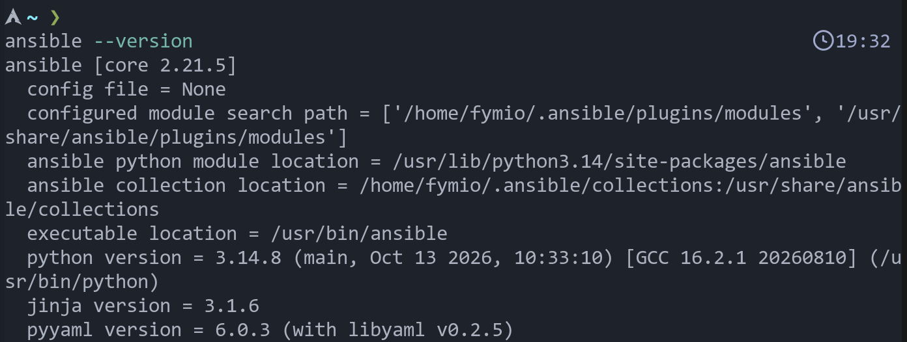

### 3.2 Целевая машина

Это виртуальная машина на том же ноутбуке.

| K | V |
|---|---|
| система | ubuntu 24.04.5 LTS |
| процессор | 2 ядра |
| память | 6 ГБ, система видит 5.8 ГБ |
| диск | 20 ГБ |
| имя машины | `os-lab` |
| адрес в сети | `192.168.122.190` |
| пользователь для ansible | `ansible`, вход по ssh ключу, права sudo без пароля |

### 3.3 Как создавалась виртуальная машина

Установил программы для виртуальных машин и запустил сеть libvirt.

```bash
sudo pacman -S --needed qemu-full libvirt virt-install virt-manager dnsmasq swtpm edk2-ovmf
sudo systemctl enable --now libvirtd.service
sudo virsh net-start default
sudo virsh net-autostart default
```

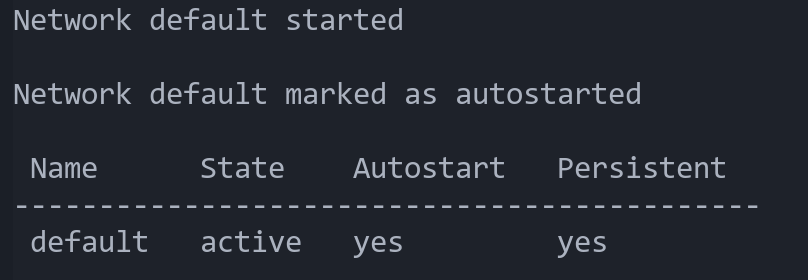

Дальше скачал готовый образ ubuntu и создал под него диск на 20 гб.

```bash
sudo curl -L -o /var/lib/libvirt/images/noble-base.img \
  https://cloud-images.ubuntu.com/noble/current/noble-server-cloudimg-amd64.img

sudo qemu-img create -f qcow2 -F qcow2 \
  -b /var/lib/libvirt/images/noble-base.img \
  /var/lib/libvirt/images/os-lab.qcow2 20G
```

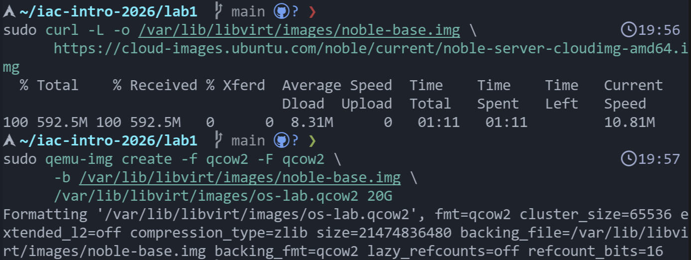

Пользователя и ssh ключ в машину кладёт программа cloud init при первом запуске. Для неё я написал файл `user-data`, он лежит в корне проекта.

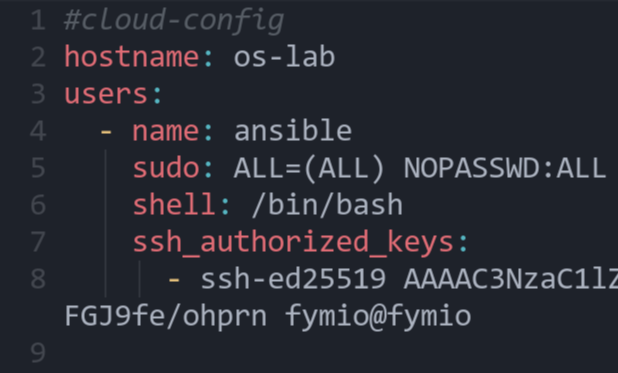

Запуск виртуальной машины.

```bash
sudo virt-install --connect qemu:///system \
  --name os-lab --memory 6144 --vcpus 2 --import \
  --disk /var/lib/libvirt/images/os-lab.qcow2 \
  --os-variant ubuntu24.04 \
  --network network=default \
  --cloud-init user-data=$PWD/user-data \
  --noautoconsole
```

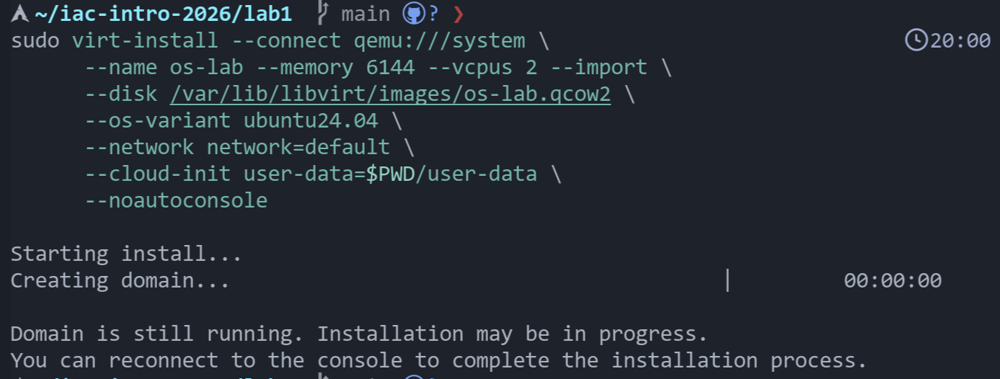

Адрес машины можно узнать так.

```bash
sudo virsh domifaddr os-lab
```

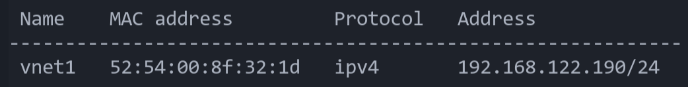

Вход по ssh работает, интернет внутри машины есть.

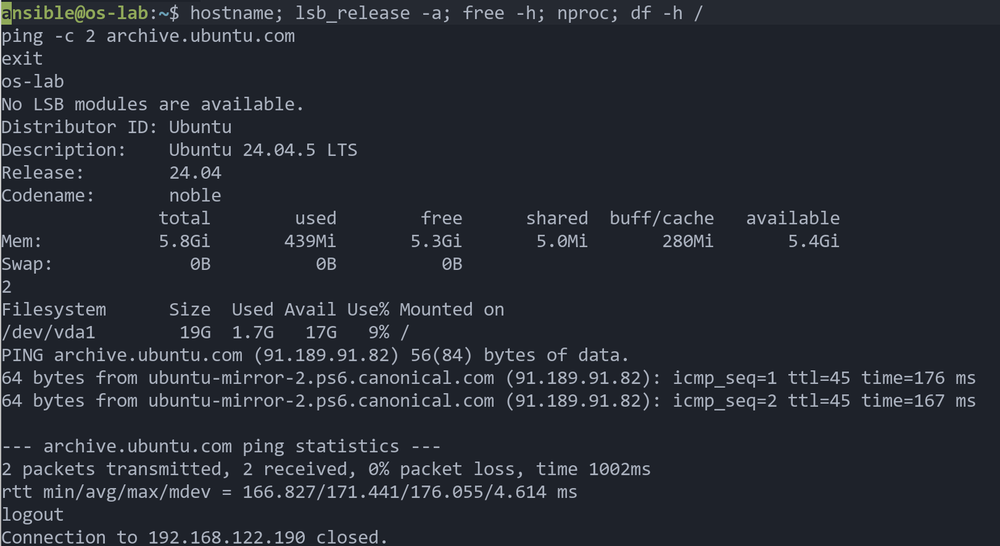

### 3.4 Проблема с сетью и как я её решил

Сначала машина не получала адрес. Причина оказалась в межсетевом экране `ufw` на ноутбуке. Он отбрасывал запросы машины на получение адреса. Выключать защиту целиком я не стал, а только разрешил трафик нужного сетевого интерфейса.

```bash
sudo ufw allow in on virbr0
sudo ufw allow out on virbr0
sudo ufw route allow in on virbr0
sudo ufw route allow out on virbr0
sudo ufw reload
```

После этого машина получила адрес и вышла в интернет.

## 4. Структура проекта

```
lab1/
├── ansible.cfg                  настройки ansible для проекта
├── site.yml                     плейбук, который запускает роль
├── inventory/hosts.yml          список машин
├── group_vars/all/vault.yml     пароль администратора, зашифрован
├── user-data                    настройка виртуальной машины при первом запуске
├── assets/                      скриншоты для отчёта
└── roles/opensearch/
    ├── defaults/main.yml        параметры, которые можно менять
    ├── vars/main.yml            внутренние значения роли
    ├── tasks/                   шаги установки, по одному файлу на этап
    │   ├── main.yml
    │   ├── assert.yml
    │   ├── prereqs.yml
    │   ├── install.yml
    │   ├── configure.yml
    │   ├── service.yml
    │   ├── verify.yml
    │   └── dashboards.yml
    ├── templates/               шаблоны файлов настроек
    │   ├── opensearch.yml.j2
    │   ├── opensearch_dashboards.yml.j2
    │   ├── heap.options.j2
    │   └── opensearch-limits.conf.j2
    ├── files/restart-policy.conf  готовый файл без переменных
    ├── handlers/main.yml        обработчики перезапуска
    ├── meta/main.yml            описание роли
    ├── tests/                   проверочный плейбук и список машин для него
    └── README.md                краткая справка по роли
```

Как использована каждая папка.

| папка | что в ней |
|---|---|
| `defaults` | все настройки, которые пользователь может поменять. Oни имеют самый низкий приоритет, поэтому их легко переопределить. |
| `vars` | значения, которые менять не нужно. Это пути, имена пакетов, адреса для скачивания. |
| `tasks` | шаги установки. Они разбиты на файлы по смыслу, чтобы было проще читать. |
| `templates` | файлы настроек с подстановкой переменных. ansible сам заполняет их нужными значениями. |
| `files` | файл, который копируется как есть, без подстановок. Это правило автоматического перезапуска сервиса после сбоя. |
| `handlers` | действия, которые выполняются только если что то изменилось. У нас это перезапуск сервисов. |
| `meta` | описание роли, автор, лицензия, поддерживаемые системы. |
| `tests` | playbook, который запускает роль и проверяет итог. |

## 5. Как работает роль

Файл `tasks/main.yml` подключает этапы по порядку.

1. Проверка входных данных в `assert.yml`. Роль убеждается, что система из семейства debian, что архитектура процессора поддерживается и что задан пароль администратора длиной хотя бы 8 символов. Если что то не так, роль остановится сразу и объяснит причину.
2. Подготовка системы в `prereqs.yml`. Ставятся нужные программы и выставляется параметр ядра `vm.max_map_count`. Это число областей памяти, которые процесс может отобразить в файлы. opensearch требует не меньше 262144, иначе в боевом режиме он откажется запускаться.
3. Установка opensearch в `install.yml`. Пакет `.deb` скачивается с официального сайта с тремя попытками на случай сбоя сети, затем ставится через `apt`. Пароль администратора передаётся пакету через переменную окружения `OPENSEARCH_INITIAL_ADMIN_PASSWORD`, без него opensearch версии 3 не запустится. Для этой задачи включён `no_log`, чтобы пароль не попал в вывод.
4. Настройка в `configure.yml`. Создаются каталоги для данных и журналов, из шаблонов собираются файлы настроек, размер памяти java и ограничение на число открытых файлов для сервиса. Также копируется правило, по которому systemd поднимает сервис заново после сбоя. systemd это система управления службами в linux.
5. Запуск сервиса в `service.yml`. Сначала принудительно выполняются накопленные обработчики, затем сервис включается в автозапуск и запускается.
6. Проверка готовности в `verify.yml`. Роль обращается к адресу `_cluster/health` и повторяет запрос, пока не получит ответ 200 со статусом `green` или `yellow`. Попыток не больше 30, пауза между ними 10 секунд, то есть самое большее 5 минут. После этого результат выводится на экран.
7. Установка Dashboards в `dashboards.yml`. Всё то же самое для веб интерфейса, плюс проверка, что он отвечает на порту 5601. Этот этап можно отключить переменной.

## 6. Параметры роли

Все параметры лежат в `defaults/main.yml`. В параметры вынесено то, что в реальной жизни у разных людей разное или что со временем меняется. Всё остальное зашито в роль, чтобы пользователю не пришлось в нём разбираться.

| параметр | значение по умолчанию | зачем он нужен |
|---|---|---|
| `opensearch_version` | `"3.8.0"` | версия, которую нужно поставить. Для обновления достаточно поменять одну строку. |
| `opensearch_dashboards_version` | как у opensearch | версии должны совпадать, иначе интерфейс может не работать с поиском. |
| `opensearch_download_base_url` | официальный сайт | можно указать своё зеркало, если нет доступа к основному сайту. |
| `opensearch_dashboards_install` | `true` | позволяет поставить только opensearch без интерфейса. |
| `opensearch_admin_password` | пустое | пароль администратора. Он намеренно пустой, чтобы его пришлось задать снаружи и он не оказался в открытом виде в репозитории. Хранится в зашифрованном файле ansible vault. |
| `opensearch_dashboards_os_user` и `opensearch_dashboards_os_password` | `kibanaserver` | служебная учётная запись, под которой интерфейс обращается к opensearch. |
| `opensearch_cluster_name` | `opensearch-lab` | имя кластера. Кластер это группа узлов opensearch, у нас в ней один узел. |
| `opensearch_node_name` | имя машины из списка | имя узла, чтобы его было легко узнать в журналах. |
| `opensearch_network_host` | `127.0.0.1` | на каком адресе слушает opensearch. По умолчанию только на самой машине, это безопаснее. Для доступа извне ставится `0.0.0.0`. |
| `opensearch_http_port` | `9200` | порт opensearch. Его можно поменять, если он занят. |
| `opensearch_dashboards_host` | `0.0.0.0` | интерфейс должен быть виден с другой машины, иначе им нельзя пользоваться через браузер. |
| `opensearch_dashboards_port` | `5601` | порт интерфейса. |
| `opensearch_heap_size` | `"1g"` | объём памяти java для opensearch. Это самая важная настройка производительности. Правило такое, что нужно брать не больше половины памяти машины. Один гигабайт подходит для нашей машины на 6 гб. |
| `opensearch_vm_max_map_count` | `262144` | требование opensearch к ядру linux. |
| `opensearch_nofile_limit` | `65535` | сколько файлов сервис может открыть одновременно. opensearch открывает их очень много. |
| `opensearch_data_dir` | `/var/lib/opensearch` | где хранятся данные. Их часто выносят на отдельный диск. |
| `opensearch_log_dir` | `/var/log/opensearch` | где лежат журналы. |
| `opensearch_security_settings` | демо настройки из пакета | набор настроек защиты, который пакет сам добавляет при установке. Я вынес его в параметр, чтобы он не потерялся при создании файла настроек из шаблона. |
| `opensearch_compliance_salt` | строка из 16 символов | служебная соль для журнала аудита. |
| `opensearch_extra_config` | пусто | сюда можно добавить любые другие настройки opensearch без правки шаблона. |
| `opensearch_dashboards_extra_config` | пусто | то же самое для dashboards. |
| `opensearch_service_enabled` | `true` | включать ли автозапуск. |
| `opensearch_service_state` | `started` | нужное состояние сервиса. Если поставить `stopped`, роль его остановит и проверку пропустит. |
| `opensearch_wait_retries` | `30` | сколько раз проверять готовность. Это то самое ограничение числа попыток. |
| `opensearch_wait_delay` | `10` | пауза между проверками в секундах. |
| `opensearch_validate_certs` | `false` | проверять ли сертификат. Из пакета идёт самоподписанный сертификат для демонстрации, поэтому проверка отключена. |
| `opensearch_expected_status` | `green` и `yellow` | какие статусы здоровья кластера считаются нормой. |

Внутренние значения в `vars/main.yml` менять не нужно. Это каталоги настроек, список необходимых пакетов, соответствие архитектуры процессора и названия пакета, а также собранные адреса для скачивания.

## 7. Шаблоны jinja2

jinja2 - это язык шаблонов. В файле пишутся обычные настройки, а на место переменных ansible подставляет значения.

* `opensearch.yml.j2` собирает основной файл настроек opensearch. В нём имя кластера, узла, каталоги, адрес и порт, режим одного узла, затем в цикле выводится набор настроек защиты и дополнительные настройки.
* `opensearch_dashboards.yml.j2` собирает настройки интерфейса. Адрес и порт самого интерфейса, адрес opensearch, имя и пароль служебной учётной записи.
* `heap.options.j2` задаёт размер памяти java. Он кладётся отдельным файлом в папку `jvm.options.d`, поэтому основной файл пакета остаётся нетронутым.
* `opensearch-limits.conf.j2` задаёт сервису предел числа открытых файлов.

Пример, как выглядит шаблон памяти.

```
-Xms{{ opensearch_heap_size }}
-Xmx{{ opensearch_heap_size }}
```

## 8. Обработчики

В файле `handlers/main.yml` два обработчика, один перезапускает opensearch, другой dashboards. Задачи, которые меняют настройки, вызывают их через `notify`. Если файл не изменился, обработчик не запускается и сервис не перезапускается. Для opensearch это три шаблона и один копируемый файл. Для dashboards это его файл настроек и правило перезапуска после сбоя.

## 9. Запуск

Установка расширения для настройки ядра, если его ещё нет.

```bash
ansible-galaxy collection install ansible.posix
```

Пароль администратора лежит в `group_vars/all/vault.yml`. Файл зашифрован командой `ansible-vault encrypt`. Пароль от самого хранилища записан в файл `.vault_pass`, он добавлен в `.gitignore` и в репозиторий не попадает. В `ansible.cfg` указано, где его брать, поэтому вводить его вручную не нужно.

Проверка связи с машиной.

```bash
ansible all -m ping
```

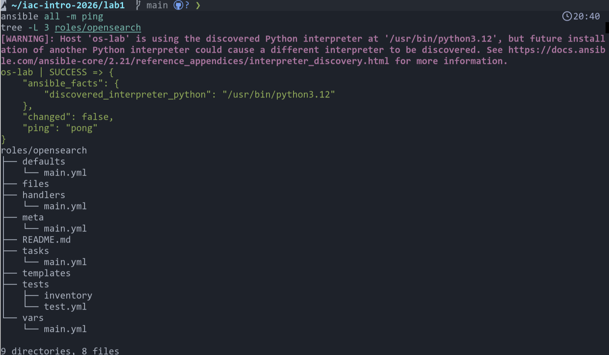

Проверка, что пакеты с нужной версией существуют на сайте.

```bash
curl -sI https://artifacts.opensearch.org/releases/bundle/opensearch/3.8.0/opensearch-3.8.0-linux-x64.deb | head -1
curl -sI https://artifacts.opensearch.org/releases/bundle/opensearch-dashboards/3.8.0/opensearch-dashboards-3.8.0-linux-x64.deb | head -1
```

Оба ответа `HTTP/2 200` означают, что файлы найдены.

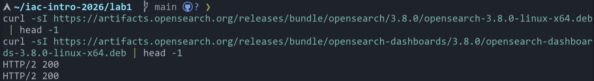

Шифрование пароля администратора.

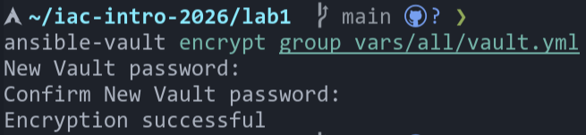

Основной запуск.

```bash
ansible-playbook site.yml
```

## 10. Проверка работоспособности

### 10.1 Установка и первый запуск

Роль писалась по частям, поэтому сначала запускалась только установка пакета. Первый такой запуск я прервал вручную, потому что скачивание шло слишком медленно из за настроек сети на ноутбуке. Повторный запуск прошёл нормально.

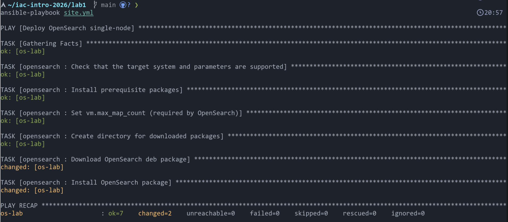

Повторный запуск ничего не изменил. Здесь видно, что `changed=0`.

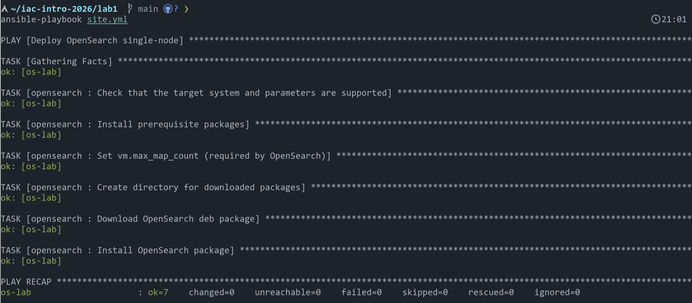

После установки пакета служба была выключена и не запущена. Это проверялось командой ниже, она показала `disabled` и `inactive`. Значит автозапуск и старт действительно остаются на роли.

```bash
ssh ansible@192.168.122.190 'dpkg -l opensearch | tail -1; systemctl is-enabled opensearch; systemctl is-active opensearch'
```

```
ii  opensearch     3.8.0        amd64        An open source distributed and RESTful search engine
disabled
inactive
```

### 10.2 Полный запуск роли для opensearch

Ниже конец вывода при запуске с настройкой и запуском сервиса. В нём видно, что обработчик перезапуска сработал один раз, а проверка готовности с первой попытки не прошла, потому что сервис ещё поднимался. Роль подождала и со второй попытки получила ответ. Это и есть ограниченное число попыток в действии.

```
TASK [opensearch : Render opensearch.yml] ***
changed: [os-lab]

TASK [opensearch : Render JVM heap settings] ***
changed: [os-lab]

TASK [opensearch : Create systemd drop-in directory] ***
changed: [os-lab]

TASK [opensearch : Render systemd drop-in with limits] ***
changed: [os-lab]

TASK [opensearch : Apply pending configuration changes] ***

RUNNING HANDLER [opensearch : Restart opensearch] ***
changed: [os-lab]

TASK [opensearch : Enable OpenSearch at boot and ensure desired state] ***
changed: [os-lab]

TASK [opensearch : Wait for OpenSearch API and acceptable cluster status] ***
FAILED - RETRYING: Wait for OpenSearch API and acceptable cluster status (29 retries left).
ok: [os-lab]
```

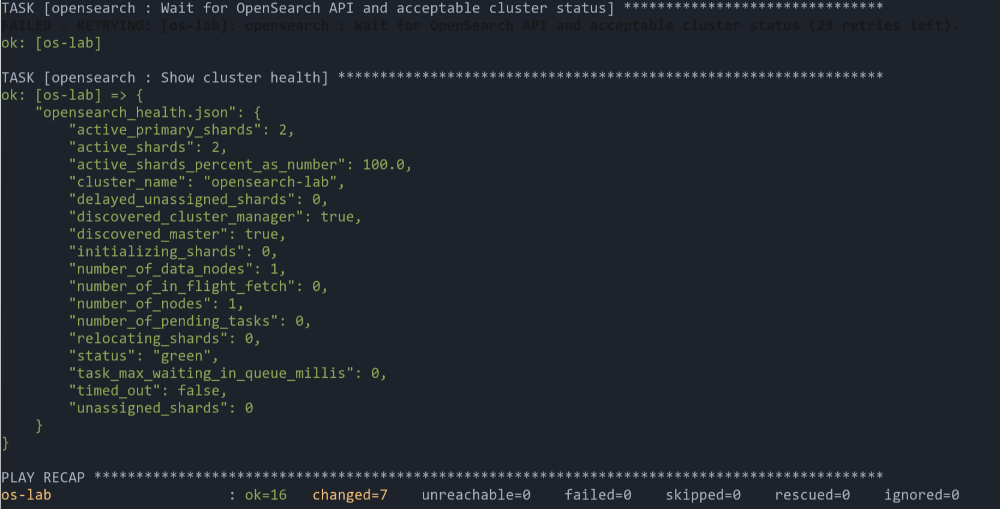

Повторный запуск сразу после этого. Изменений нет, перезапуска нет.

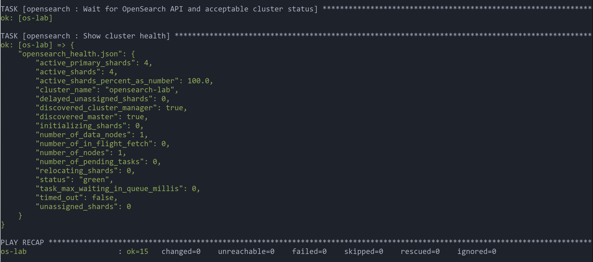

### 10.3 Проверка здоровья кластера

Главная проверка из задания. Запрос к адресу `_cluster/health` прямо на машине.

```bash
ssh ansible@192.168.122.190 "curl -sk -u 'admin:<pass>' 'https://127.0.0.1:9200/_cluster/health?pretty'; systemctl is-enabled opensearch; systemctl is-active opensearch"
```

Пароль на скриншоте закрыт.

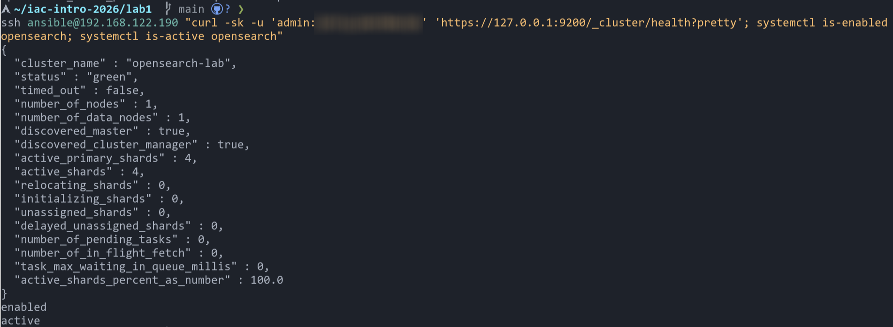

Что здесь видно.

* Статус `green`, то есть всё в порядке. Статус `yellow` значил бы, что часть копий данных не размещена, `red` значил бы, что часть данных недоступна.
* Один узел, он же хранит данные и управляет кластером.
* Все шарды размещены, неразмещённых нет. Шард это часть индекса, на которые opensearch делит данные.
* Сервис включён в автозапуск и работает.

### 10.4 opensearch dashboards

Установка интерфейса. Видно, что пакет скачан и установлен, настройки созданы, обработчик перезапустил сервис, а проверка готовности интерфейса со второй попытки прошла.

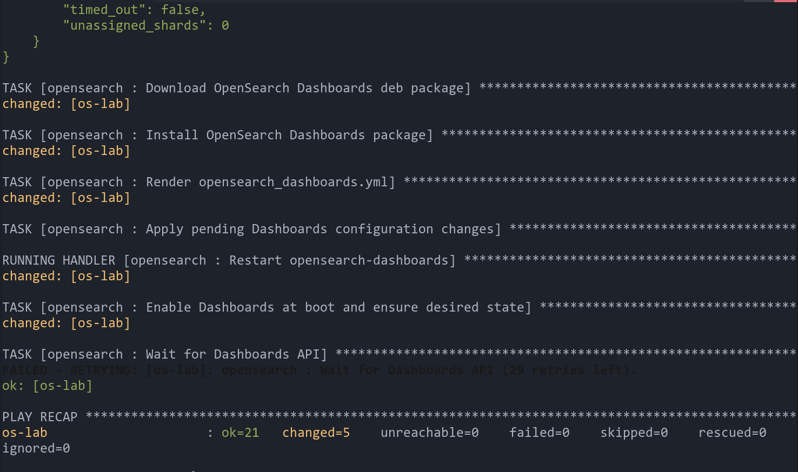

Сервис включён и работает, интерфейс слушает порт 5601 на всех адресах, а opensearch порт 9200 только на самой машине. Так и задумано.

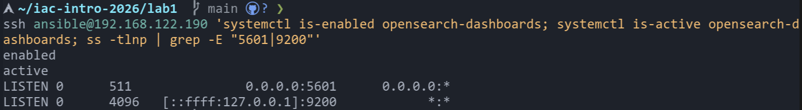

Интерфейс открывается в браузере на ноутбуке по адресу `http://192.168.122.190:5601`. Вход под пользователем `admin`.


Повторный запуск роли вместе с dashboards ничего не меняет.

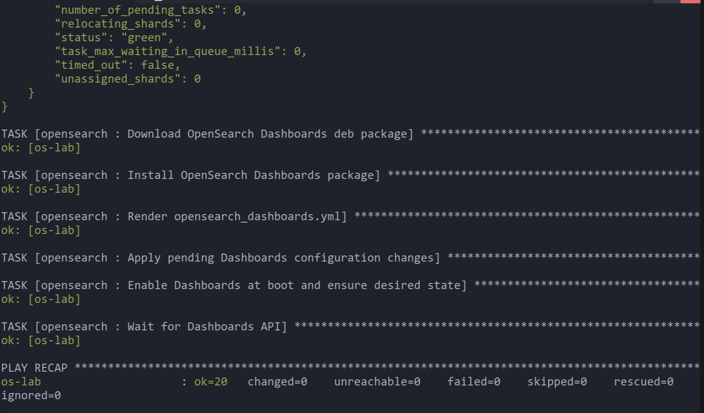

### 10.5 Обработчики и лишние перезапуски

Чтобы убедиться, что перезапуск идёт только при изменении настроек, я запустил роль с другим размером памяти.

```bash
ansible-playbook site.yml -e opensearch_heap_size=768m
```

Изменился один шаблон, значит сработал один обработчик перезапуска opensearch. dashboards при этом не трогался.

```
TASK [opensearch : Render JVM heap settings] ***
changed: [os-lab]

RUNNING HANDLER [opensearch : Restart opensearch] ***
changed: [os-lab]

PLAY RECAP ***
os-lab : ok=24  changed=2  unreachable=0  failed=0
```

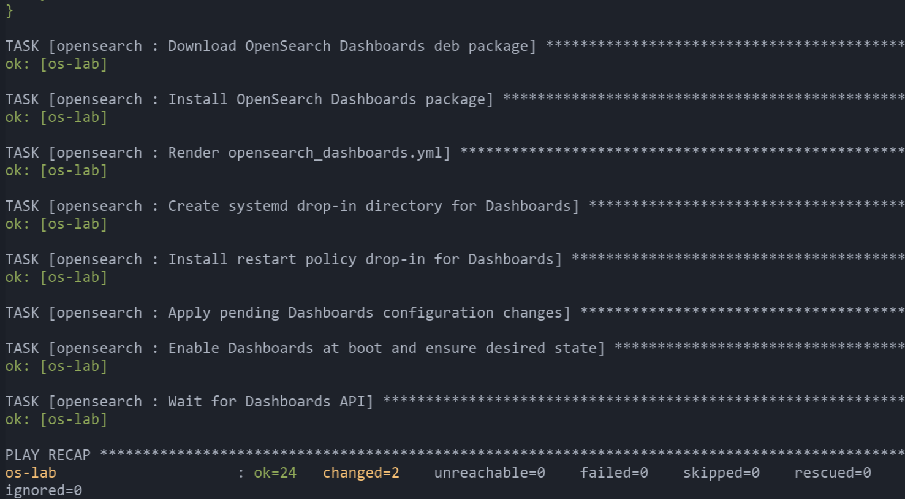

Проверим, что новое значение действительно применилось. Запрашиваем у opensearch максимальный размер памяти. 768 мегабайт это 805306368 байт.

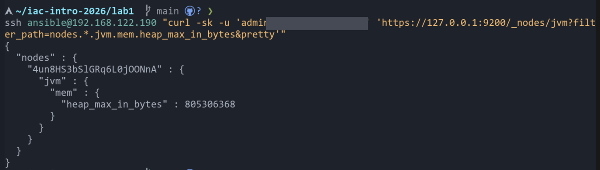

Значит настройка дошла до работающей программы. Затем я запустил роль без этого параметра, и размер памяти вернулся к одному гигабайту, с одним перезапуском. Следующий запуск уже ничего не менял, перезапусков нет.

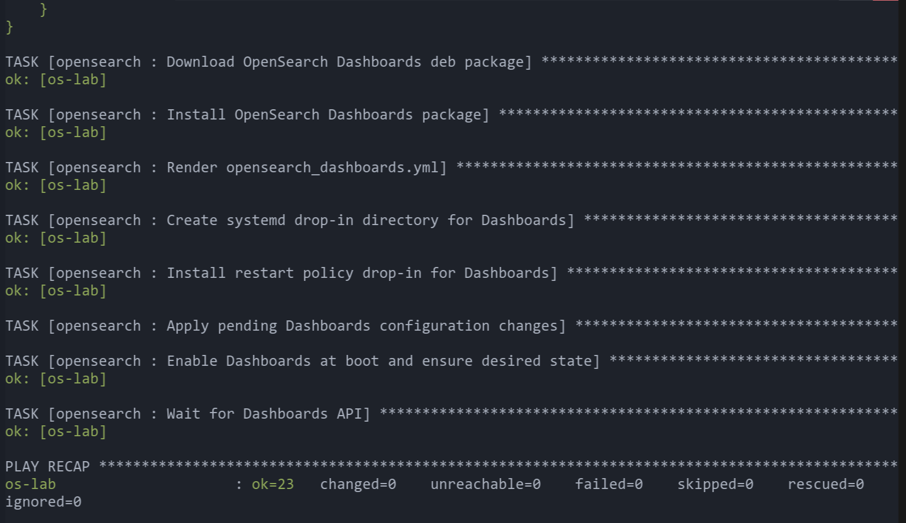

### 10.6 Автозапуск после перезагрузки

Перезагрузка машины через ansible.

```bash
ansible all -b -m reboot
```

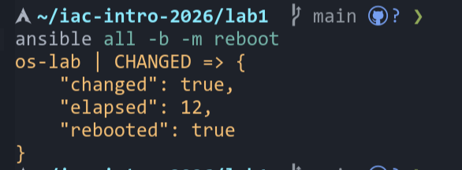

Сразу после возвращения машины, без запуска плейбука, проверяем службы и запускаем только этап проверки готовности.

```bash
ssh ansible@192.168.122.190 'uptime -p; systemctl is-enabled opensearch opensearch-dashboards; systemctl is-active opensearch opensearch-dashboards'
ansible-playbook site.yml --tags opensearch_verify
```

Машина работает меньше минуты, обе службы включены и запущены, кластер отвечает со статусом `green`. Значит автозапуск работает.

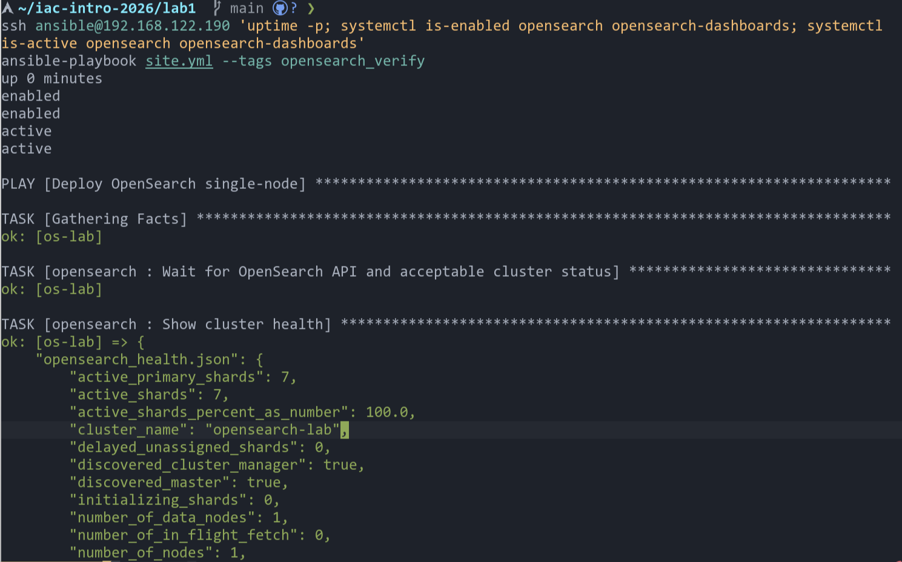

### 10.7 Проверочный плейбук

В `roles/opensearch/tests/test.yml` лежит плейбук, который запускает роль и затем сам проверяет, что службы включены и работают, а кластер имеет статус `green` или `yellow`.

```bash
ansible-playbook -i roles/opensearch/tests/inventory roles/opensearch/tests/test.yml
```

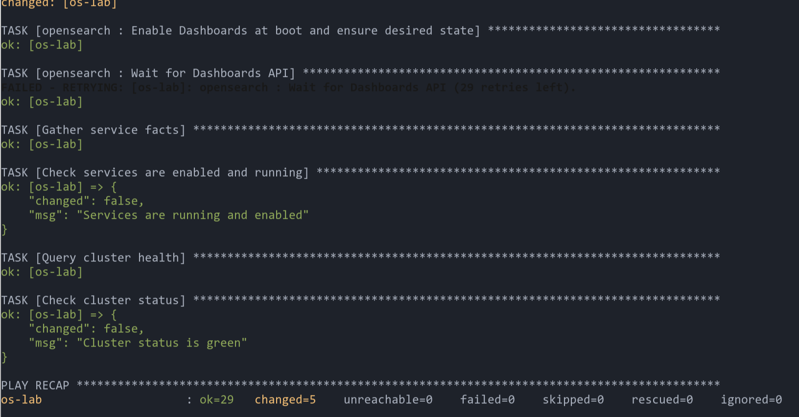

Роль также проверена программой `ansible-lint`, которая ищет типичные ошибки в стиле и в записи задач. Сначала она нашла три замечания, я их исправил, и теперь замечаний нет.

## 11. Безопасность и допущения

* Пароль администратора хранится в зашифрованном файле ansible vault. Файл с паролем от хранилища в репозиторий не попадает.
* Задачи с паролем закрыты параметром `no_log`, поэтому пароль не печатается в выводе.
* opensearch по умолчанию слушает только свою машину, наружу открыт только интерфейс.
* Используются демонстрационные сертификаты и демонстрационная учётная запись `kibanaserver`, которые поставляются вместе с пакетом.
* Режим одного узла подходит для обучения и разработки. Для надёжной работы нужно несколько узлов.

## 12. Выводы

Я написал роль ansible, которая с нуля ставит и настраивает opensearch и opensearch dashboards версии 3.8.0 на ubuntu. Роль работает с параметрами, собирает настройки из шаблонов, перезапускает сервисы только при реальных изменениях, ждёт готовности с ограниченным числом попыток и включает автозапуск. Проверки показали, что кластер имеет статус `green`, повторный запуск ничего не меняет, а после перезагрузки всё поднимается само.

Отдельно разобрался с разницей между подходами. ansible выполняет шаги, которые мы описали, и именно поэтому важно, чтобы каждый шаг был идемпотентным, то есть приводил систему к нужному состоянию и не менял её, если оно уже достигнуто.
