# Лабораторная работа 2

## 1. Цель работы

Нужно было взять свою роль `opensearch` из первой лабораторной и сделать с ней две вещи. Сначала научить её настраивать безопасность, то есть создавать роли, пользователей и data stream через security rest api. Потом покрыть всё это автоматическими тестами в molecule, чтобы после каждого изменения можно было одной командой проверить, что роль по-прежнему работает.

Несколько терминов, которые встретятся дальше.

* Molecule - это программа для тестирования ролей ansible. Она по очереди создаёт тестовую среду, применяет роль, запускает её второй раз для проверки идемпотентности, выполняет наши проверки и убирает за собой.
* Идемпотентность значит, что повторный запуск роли ничего не меняет, если всё уже настроено.
* Data stream - это особый вид индекса для логов. Писать в него можно только новые записи, а за скрытыми служебными индексами он следит сам.
* Шаблон индекса говорит opensearch, с какими настройками создавать новые индексы и data stream.
* Роль в opensearch это набор прав. Пользователю права выдаются не напрямую, а через привязку к роли, она называется role mapping.
* Security rest api это адреса, через которые роли и пользователей можно создавать обычными запросами, без ручной работы в интерфейсе.

## 2. Что получилось

* В роль добавлен файл `tasks/security.yml`. Он создаёт шаблон индекса, data stream, три роли, трёх пользователей и привязывает каждого к своей роли.
* Все значения лежат в `defaults/main.yml`, поэтому права и имена можно менять, не трогая сами задачи.
* Задачи безопасности идемпотентны. Повторный запуск показывает `changed=0`.
* Написан сценарий molecule с четырьмя наборами проверок. Это сценарии 0, 1, 2 и 3 из задания.
* Полный прогон `molecule test` проходит без ошибок.

## 3. Окружение

Всё то же самое, что и в первой лабораторной.

| K | V |
|---|---|
| управляющая машина | cachyOS, ноутбук |
| ansible | core 2.21.5 |
| molecule | 26.10.0 |
| python | 3.14.8 |
| целевая машина | виртуальная машина ubuntu 24.04, адрес `192.168.122.190` |
| opensearch | 3.8.0 |

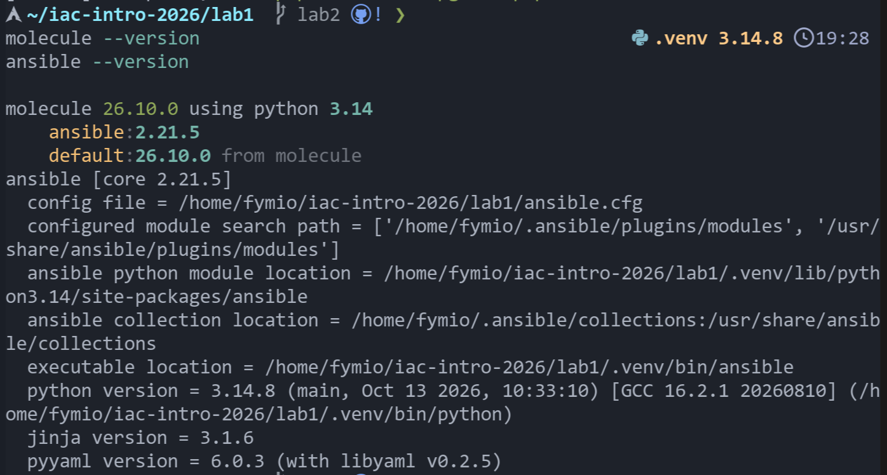

Molecule обычно поднимает тестовую среду в docker. Я так не делал, потому что opensearch тяжёлый, а у меня уже есть готовая виртуальная машина. Поэтому тесты идут прямо на ней, а между прогонами molecule сама удаляет все пакеты и файлы, чтобы каждый тест начинался с чистой системы.

## 4. Что добавилось в проект

```
lab1/
├── group_vars/all/vault.yml           пароли, зашифрованы
├── .vault_pass                        пароль от хранилища, не попадает в git
└── roles/opensearch/
    ├── defaults/main.yml              добавлены роли, пользователи, шаблон
    ├── tasks/
    │   ├── main.yml                   подключён security.yml
    │   ├── assert.yml                 проверка, что пароли заданы
    │   └── security.yml               новые задачи безопасности
    └── molecule/default/
        ├── molecule.yml               описание сценария и порядок шагов
        ├── inventory.yml              адрес тестовой машины
        ├── create.yml                 проверка, что машина доступна
        ├── converge.yml               применение роли
        ├── destroy.yml                полная очистка машины
        ├── verify.yml                 запуск всех проверок
        ├── group_vars/all/vault.yml   пароли для тестов, зашифрованы
        └── tests/
            ├── test0_service.yml
            ├── test1_writer.yml
            ├── test2_reader.yml
            └── test3_operator.yml
```

## 5. Часть 1. Ролевая модель

### 5.1 Шаблон индекса и data stream

Сначала нужен шаблон, потому что data stream можно создать только под готовый шаблон. Он описан в переменной `opensearch_index_template_body`.

```yaml
opensearch_index_template_body:
  index_patterns: ["logs"]
  data_stream: {}
  priority: 200
  template:
    settings:
      number_of_shards: 1
      number_of_replicas: 0
    mappings:
      properties:
        "@timestamp": { type: date }
        message: { type: text }
        level: { type: keyword }
```

Копий шардов ноль, потому что узел у нас один и класть копии некуда. Если оставить единицу, кластер навсегда останется жёлтым. Поля описаны явно, чтобы тип у времени всегда был `date`, а не угадывался по первому документу.

### 5.2 Три роли

Роли описаны в переменной `opensearch_security_roles` и отправляются в OpenSearch запросом PUT.

| Роль | Что разрешено | Чего нет |
|---|---|---|
| `logs_writer` | запись только в data stream `logs` | чтения и управления кластером |
| `logs_reader` | чтение индексов `logs*` | записи, удаления, других индексов |
| `cluster_operator` | информация о кластере и изменение его настроек | любого доступа к данным индексов |

Роль записи.

```yaml
logs_writer:
  cluster_permissions:
    - "indices:data/write/bulk"
  index_permissions:
    - index_patterns: ["logs", ".ds-logs-*"]
      allowed_actions:
        - "indices:data/write/index"
        - "indices:data/write/bulk*"
        - "indices:admin/mapping/auto_put"
```

Здесь два момента, которые я не сразу понял. Данные data stream физически лежат в скрытых индексах с именами вида `.ds-logs-000001`, поэтому права нужны и на них тоже. А право `bulk` у OpenSearch считается правом на уровне кластера, без него не работает пакетная запись. Но оно ничего не читает и ничем не управляет, так что требование про отсутствие прав на чтение и управление кластером остаётся выполненным.

Роль чтения.

```yaml
logs_reader:
  cluster_permissions: []
  index_permissions:
    - index_patterns: ["logs*"]
      allowed_actions: ["read"]
```

Роль администратора кластера.

```yaml
cluster_operator:
  cluster_permissions:
    - "cluster_monitor"
    - "cluster:admin/settings/update"
  index_permissions: []
```

Группа `cluster_monitor` даёт право смотреть здоровье, состояние и настройки. Второе право позволяет эти настройки менять. Список прав на индексы пустой, значит к данным этот пользователь не доберётся.

### 5.3 Пользователи и привязка к ролям

| Пользователь | Роль |
|---|---|
| `writer` | `logs_writer` |
| `reader` | `logs_reader` |
| `operator` | `cluster_operator` |

Пользователи создаются через `internalusers`, а привязка делается через `rolesmapping`. В обоих случаях это обычные запросы PUT из модуля `ansible.builtin.uri`.

### 5.4 Пароли

В открытом виде пароли нигде не лежат.

* В `defaults/main.yml` для них стоят пустые значения.
* Настоящие значения лежат в файле `group_vars/all/vault.yml`, зашифрованном Ansible Vault.
* Для тестов у роли есть свой такой же зашифрованный файл в `molecule/default/group_vars/all/vault.yml`.
* Пароль от самого хранилища лежит в `.vault_pass`, этот файл добавлен в `.gitignore`.
* Задача создания пользователей закрыта параметром `no_log`, поэтому пароли не попадают в вывод.
* Если пароль не задан или короче восьми символов, роль останавливается сразу в `assert.yml`, ещё до установки.

Пароли можно передать и при запуске, например командой `-e opensearch_writer_password=...`, но хранилище удобнее.

### 5.5 Как устроены задачи

Задачи в `security.yml` идут в таком порядке.

1. Проверить, есть ли шаблон, и создать или обновить его.
2. Проверить, есть ли data stream, и создать, если его нет.
3. Создать или обновить роли.
4. Создать или обновить пользователей.
5. Привязать роли к пользователям.

Чтобы задачи были идемпотентными, я не опираюсь на то, что сделал сам запрос. Запрос PUT всегда отвечает успехом, даже если ничего не изменилось. Поэтому для ролей, пользователей и привязок я смотрю на ответ opensearch. Слово `CREATED` значит, что объект был создан только что, и тогда задача считается изменившей систему. Для шаблона сначала выполняется отдельная проверка, а для data stream создание вообще пропускается, если он уже есть.

Общие параметры входа вынесены в `module_defaults`, чтобы не повторять логин и пароль администратора в каждой задаче.

### 5.6 Ручная проверка

Перед тестами я проверил всё руками обычными запросами. Запись в data stream проходит с кодом 201, документ попадает в скрытый индекс `.ds-logs-000001`, а поиск находит его.

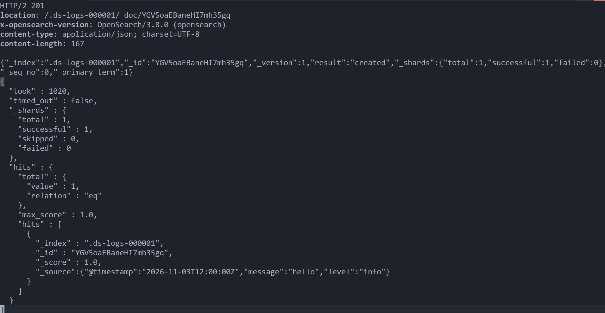

Запрещённые действия получают отказ с ошибкой `security_exception`. Поиск под пользователем `writer`, запись под `reader` и поиск под `operator` дают код 403. А у `operator` запрос настроек кластера проходит и возвращает пустые `persistent` и `transient`.

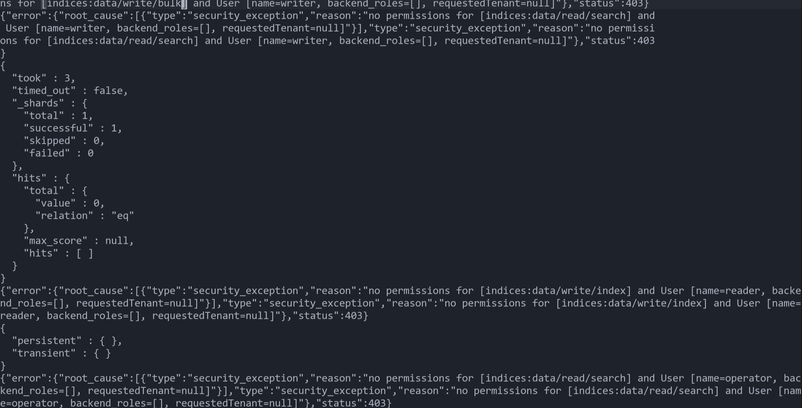

## 6. Часть 2. Автотесты в Molecule

### 6.1 Как устроен сценарий

В каталоге `roles/opensearch/molecule/default` лежит один сценарий.

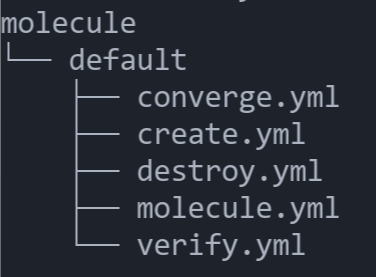

Файл `molecule.yml` задаёт порядок шагов.

```yaml
scenario:
  name: default
  test_sequence:
    - destroy
    - create
    - converge
    - idempotence
    - verify
    - destroy
```

Что делает каждый шаг.

| Шаг | Что происходит |
|---|---|
| `destroy` | останавливает службы, удаляет пакеты и все папки opensearch и drop in файлы systemd, чтобы система стала чистой |
| `create` | проверяет, что до машины можно достучаться по ssh |
| `converge` | применяет роль целиком |
| `idempotence` | применяет роль ещё раз и требует, чтобы ничего не изменилось |
| `verify` | запускает проверки из сценариев 0, 1, 2 и 3 |
| `destroy` | снова чистит машину |

Начальная очистка нужна, чтобы тест не прошёл случайно на остатках прошлого запуска. Начало первого `destroy` видно на скриншоте.

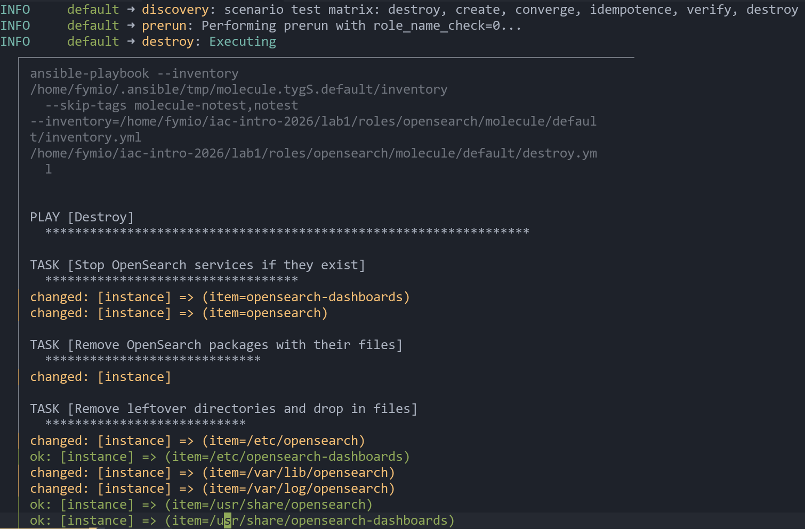

Файл `verify.yml` подключает четыре файла из папки `tests`. Перед ними он создаёт уникальную метку из текущего времени, например `molecule-1762230000`. Её записывает пользователь `writer`, а потом ищет `reader`. Так тест гарантированно находит именно тот документ, который записан в этом прогоне, а не старый.

Все проверки сделаны одним способом. Запрос выполняется через модуль `uri` на самой машине, потому что opensearch слушает только `127.0.0.1`. Затем модуль `assert` сравнивает ответ с ожидаемым значением. Для запрещённых действий в запросе сразу указан `status_code: 403`, то есть тест считается успешным только если пришёл именно отказ. После этого проверяется, что тип ошибки равен `security_exception`. Так тест не спутает отказ по правам с другой ошибкой, например с недоступным сервисом.

### 6.2 Сценарий 0. Сервис работает, а не просто запущен

Команда `systemctl status` показывает только то, что процесс жив. Он может быть жив, но не отвечать, быть недоступным или не иметь нужных настроек. Поэтому я проверяю цепочку целиком.

| Проверка | Зачем |
|---|---|
| службы `opensearch` и `opensearch-dashboards` запущены и включены в автозапуск | сервис поднимется и после перезагрузки |
| порты 9200 и 5601 принимают соединения | процесс действительно слушает сеть |
| запрос без пароля получает 401 | защита включена и аноним не пройдёт |
| версия равна 3.8.0, имя кластера `opensearch-lab` | поставилось то, что нужно, и настройки применились |
| статус кластера green или yellow, один узел, нет неразмещённых шардов | кластер здоров |
| `vm.max_map_count` не меньше 262144 | настройка ядра, без которой opensearch не работает надёжно |
| роли `logs_writer`, `logs_reader`, `cluster_operator` и пользователи `writer`, `reader`, `operator` существуют | часть 1 применилась |
| data stream `logs` существует | шаблон и data stream созданы |
| dashboards отвечает кодом 200 на `/api/status` | веб интерфейс тоже живой |

Проверки идут под администратором, кроме проверки анонимного доступа.

### 6.3 Сценарий 1. Пользователь с ролью записи

Работаем под пользователем `writer`.

| Действие | Ожидаемый результат |
|---|---|
| записать документ в data stream `logs` | код 201, результат `created` |
| выполнить поиск в `logs` | отказ 403, ошибка `security_exception` |
| записать документ в посторонний индекс | отказ 403, ошибка `security_exception` |

Запись документа выполняется с параметром `refresh=wait_for`. Он заставляет opensearch дождаться, пока документ станет виден для поиска. Без него следующий сценарий мог бы не найти документ из-за задержки.

Поиск под этой учётной записью по заданию нужно выполнить, и он должен не получиться, ведь прав на чтение у роли нет. Проверку записи в посторонний индекс я добавил от себя, чтобы убедиться, что запись действительно ограничена одним data stream.

### 6.4 Сценарий 2. Пользователь с ролью чтения

Работаем под пользователем `reader`. Перед этим администратор создаёт вспомогательный индекс `private-data`, который не подходит под шаблон `logs*`.

| Действие | Ожидаемый результат |
|---|---|
| найти в `logs*` документ из сценария 1 по его метке | документ найден |
| записать документ в data stream | отказ 403 |
| записать документ в новый индекс с именем `logs-reader-index` | отказ 403 |
| удалить data stream | отказ 403 |
| удалить скрытый индекс `.ds-logs-000001` | отказ 403 |
| прочитать индекс `private-data` | отказ 403 |

Записать и удалить пробуются и сам data stream, и обычный индекс с подходящим именем, и скрытый индекс за data stream. Так видно, что роль чтения не даёт обойти запрет разными путями.

После попыток удаления администратор проверяет, что data stream остался на месте. Вспомогательный индекс `private-data` удаляется в блоке `always`, поэтому он исчезает, даже если тест упал по дороге.

### 6.5 Сценарий 3. Администратор кластера

Работаем под пользователем `operator`.

| Действие | Ожидаемый результат |
|---|---|
| получить настройки кластера | ответ содержит раздел `persistent` |
| получить состояние кластера | в ответе правильное имя кластера и идентификатор |
| проверить версию opensearch | версия равна 3.8.0 |
| изменить настройку `cluster.max_shards_per_node` | ответ с подтверждением |
| поиск в `logs*` | отказ 403 |
| запись в data stream | отказ 403 |

Для состояния кластера я использовал `filter_path`, чтобы не получать огромный ответ целиком, а взять только имя и идентификатор. Изменение настройки нужно, чтобы доказать, что роль умеет не только смотреть, но и менять. В блоке `always` настройка возвращается к значению по умолчанию, поэтому тест не оставляет после себя следов.

## 7. Как запустить

Команды выполняются из каталога роли. Файл `.vault_pass` должен лежать в корне проекта, molecule сама находит его по переменной окружения.

```bash
cd roles/opensearch
molecule test
```

Можно запускать и по шагам.

```bash
molecule converge
molecule idempotence
molecule verify
molecule destroy
```

Шаг `verify` удобно запускать отдельно, пока дописываешь тесты, потому что роль заново ставить не нужно.

## 8. Результаты

### 8.1 Очистка и установка

Начальная очистка и установка с нуля. Роль применилась без ошибок, изменилось 17 задач, упавших нет. В конце видно, что dashboards сначала отвечал с задержкой, и роль подождала его с повтором.

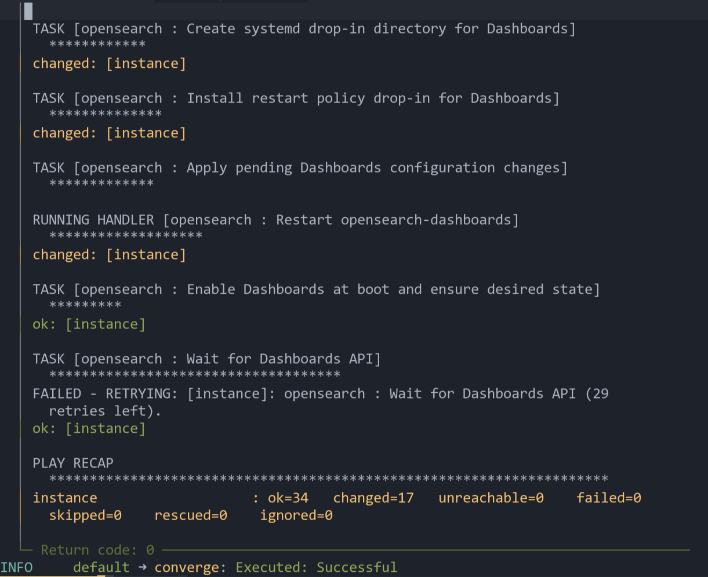

### 8.2 Идемпотентность

Это запуск первой лабораторной до добавления безопасности. Выполнено 24 задачи, изменений нет.

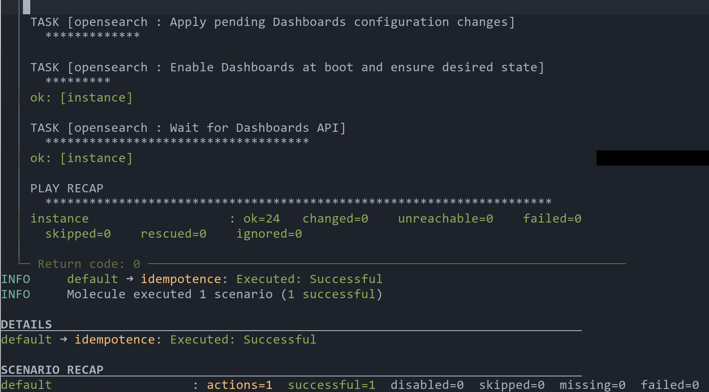

А это запуск уже с новыми задачами безопасности. Задач стало 31, одна пропущена, изменений снова нет. Значит все новые задачи идемпотентны.

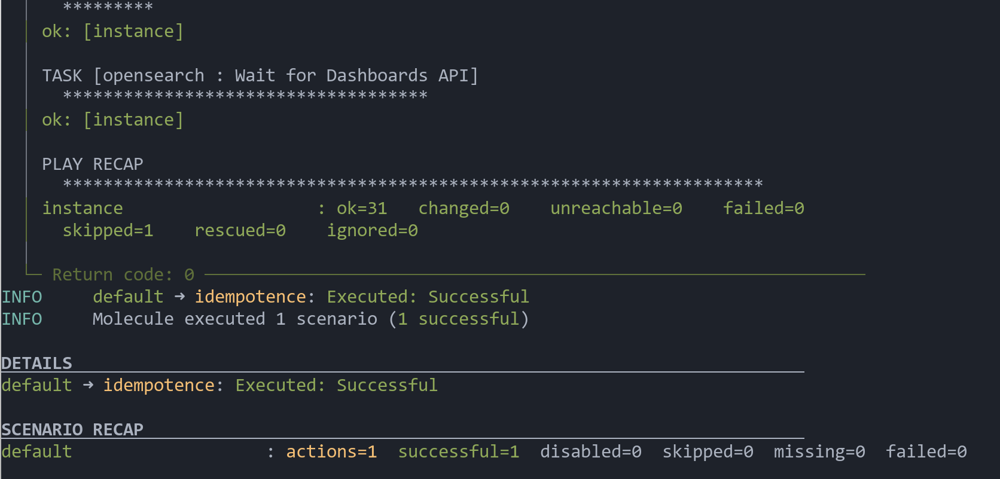

Ещё один такой же запуск дал тот же результат. Первый запуск с нуля менял 17 задач, а повторные не меняют ни одной.

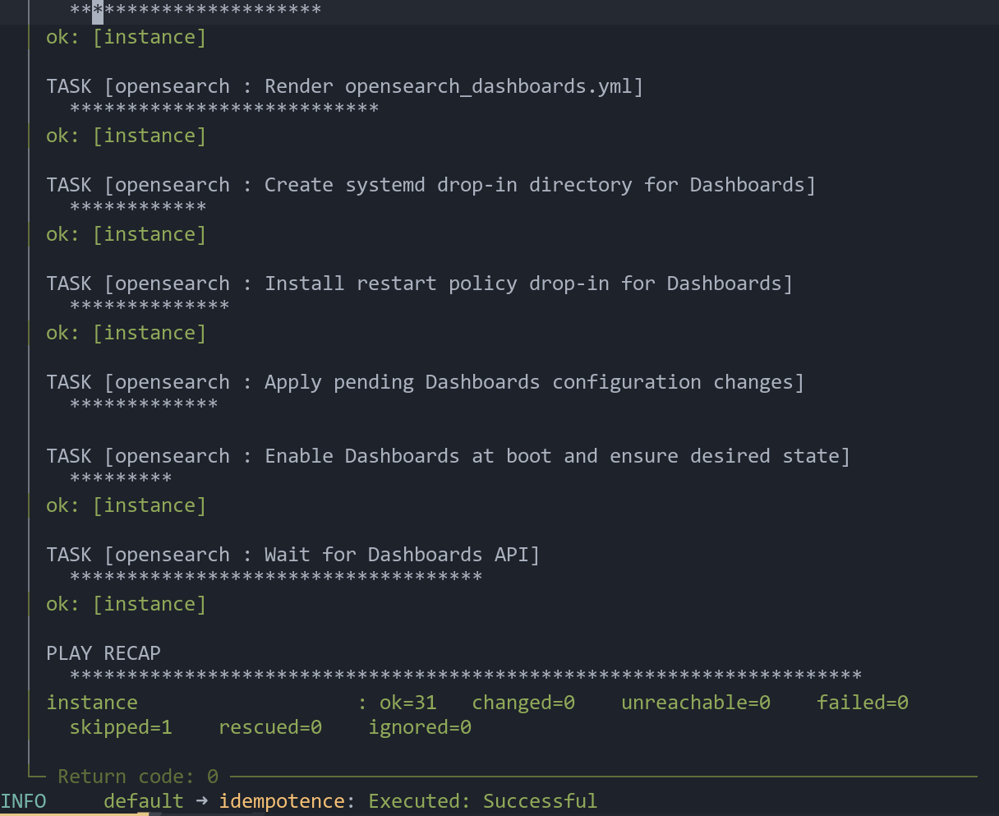

### 8.3 Проверки

Все четыре набора проверок прошли. Выполнено 48 задач, нет ни одной упавшей и ни одной изменившей систему. Параметр `changed=0` важен, потому что проверки ничего не должны менять в самой системе.

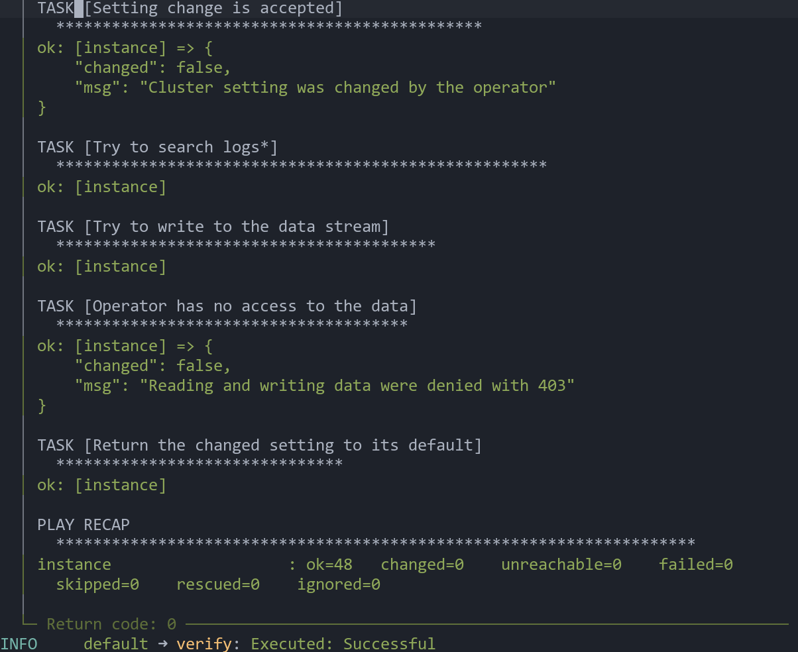

В конце шага `verify` Molecule показывает итог по сценарию.

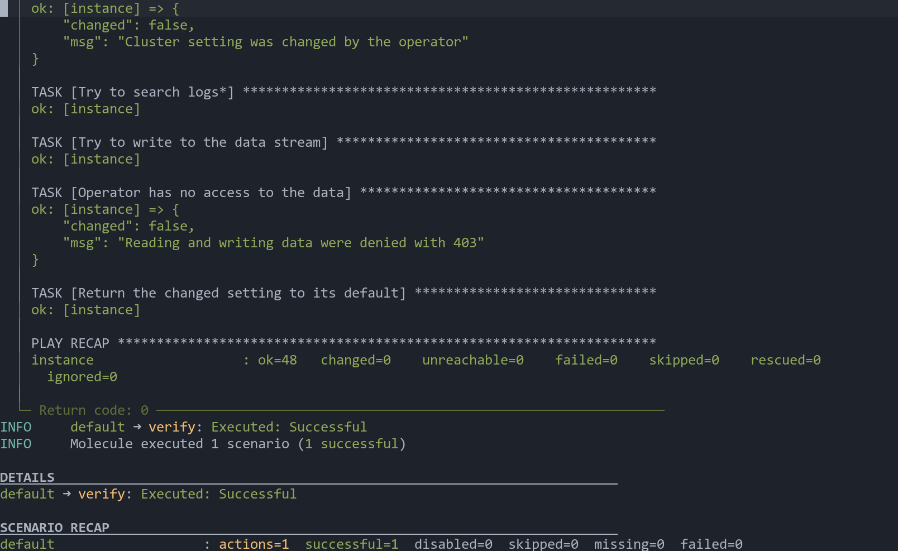

### 8.4 Полный прогон

Команда `molecule test` выполнила все шесть шагов подряд, и все шесть завершились успешно.

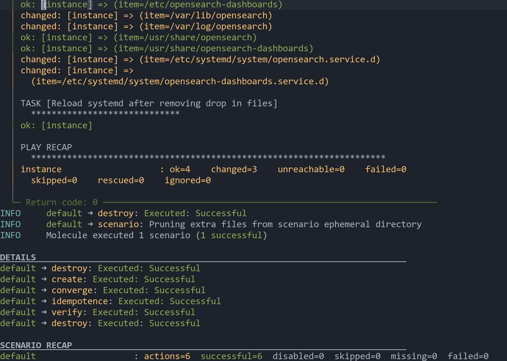

## 10. Выводы

Я расширил роль `opensearch` настройкой безопасности. Теперь она сама создаёт шаблон индекса, data stream, три роли с разными правами, трёх пользователей и привязывает их друг к другу. Пароли спрятаны в ansible vault, а повторный запуск ничего не меняет.

Для роли написан сценарий molecule. Он каждый раз начинает с чистой машины, ставит роль, проверяет идемпотентность и прогоняет четыре набора тестов. Сценарий 0 убеждается, что сервис не просто запущен, а правда работает. Сценарии 1, 2 и 3 проверяют, что каждый пользователь может делать своё и не может делать чужое.

Главное, что я вынес. Тест на запрет так же важен, как тест на разрешение. Недостаточно убедиться, что `writer` может писать. Нужно ещё проверить, что он не может читать, а `reader` не может писать и удалять. И отдельно полезно проверять не просто код ответа, а тип ошибки, чтобы отказ по правам не перепутать с обычной поломкой.
